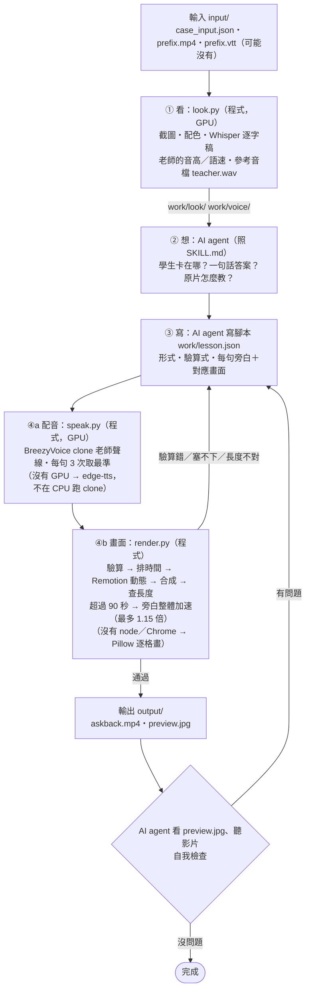

# AskBack AI 老師

學生看教學影片看到第 t 秒卡住了。這個 skill 讓 AI agent 接手：針對那一個困惑，
用原片的教法、**原片老師的聲線**做一支 **30–90 秒**的補充教學影片，再把學生送回原片。

> 2026-10-14 版：本機 RTX 3090 跑 Whisper 與 BreezyVoice clone 配音、Remotion 動態畫面；三題已在 3090 上實跑出片（見下方〈實測〉）。

## 給 agent（Claude Code／Codex）

**請完整讀過 [`SKILL.md`](SKILL.md)，照它的四個步驟做。** 摘要：

- 輸入：執行目錄下的 `input/case_input.json`、`input/prefix.mp4`，有字幕的題目另有 `input/prefix.vtt`（沒有也能做）。
- 輸出：**`output/askback.mp4`**（與 `input/` 同一層），30–90 秒、有畫面有語音、繁體中文、帶「AI 生成教學示範，非原講者本人」角標。
- 流程：`scripts/look.py`（看：截圖、逐字稿、老師的聲音）→ 你自己想清楚並寫出 `work/lesson.json`（想、寫）→ `scripts/render.py`（做：驗算、clone 配音、Remotion 畫面）。
- 不需要金鑰。預設環境有一張 RTX 3090，本機模型都跑在上面；沒有 GPU、沒有 node 也能出片（edge-tts + Pillow）。

```bash
bash <這個repo>/setup.sh                    # 一次：Python 套件、GPU 工具、Remotion（沒有 node 18+ 會自動裝到 ~/.local）
bash <這個repo>/setup.sh --tts              # 一次：本機 voice-clone TTS（BreezyVoice，需要 GPU）
python3 <這個repo>/scripts/look.py          # 看：整理題目、截圖、逐字稿、老師的聲音與語速
#   …讀材料、想清楚、寫 work/lesson.json（寫法見 SKILL.md，範例在 examples/）…
python3 <這個repo>/scripts/render.py        # 做：驗算 → clone 配音 → 排時間 → Remotion 合成 → output/askback.mp4
```

## 系統流程



- **程式做兩頭**：前面把影片變成 AI 看得懂的材料（連老師的聲音都抽好），後面把腳本變成影片。
- **AI 做中間**：理解問題、決定教法、寫腳本。agent 只寫 `lesson.json`，不碰 React／TSX。
- **兩個回頭的迴圈**：程式檢查不過會擋下來；通過後 AI 還要自己看預覽圖、聽聲音再檢查一次。

## 實測（2026-10-14，RTX 3090）

三題用同一份 `lesson.json`，比較舊流程（edge-tts＋Pillow）與新流程（clone 原片老師＋Remotion）：

| 題目 | 原片形式 | 參考音檔（自動挑出） | 每句 CER 平均 | 舊版 | 新版 |
|---|---|---|---|---|---|
| V01 認識昆蟲 | 動畫角色劇 | 女聲，02:02–02:11，8.9 秒，SNR 20.2 dB | 0.014 | 61.7 秒 | 75.8 秒 |
| V03 三位數的連加併式 | 電子黑板手寫 | 男聲，01:12–01:24，11.5 秒，SNR 19.5 dB | 0.021 | 68.6 秒 | 87.5 秒 |
| V13 豬心解剖 | 實驗實拍 | 男聲，00:22–00:33，11.5 秒，SNR 21.3 dB | 0.014 | 57.7 秒 | 57.7 秒 |

- CER 是 Whisper 把合成語音聽回來和腳本比對的錯字率，0 表示一字不差；27 句裡 17 句是 0。
- BreezyVoice 載入約 25–45 秒，之後每句（含 3 次合成與品管）約 5–40 秒；一題配音大約 2–4 分鐘。
- clone 的語速跟著老師走，比 edge-tts 慢的老師（V03）會讓影片變長，要留意 90 秒上限。
- 三版影片並排的對照頁（組內交流用）：`team/demo/2026-10-14_新舊版對照/index.html`。
- 計算節點的 Chrome 缺 `libnss3`／`libnspr4`，Remotion 開不起來時會自動退回 Pillow；這次是在計算節點配音、在登入節點用語音快取跑 Remotion。

`team/` 是組員的協作紀錄與測試成果，不屬於 skill；產生影片時不要讀取或複製其中的檔案。

## 設計：五條規則

1. 一支影片只解一個困惑。
2. 一句話只做一件事（一句旁白＝一個畫面動作）。
3. 一個畫面只放一個重點。
4. 能沿用原片的，就不要自己做（例子、顏色、形式、聲音、語速）。
5. 能算的，就不要用想的。

對應到評分：

| 評分項目 | 這個 skill 怎麼處理 |
|---|---|
| 內容正確 35% | 每個數字寫成 `checks` 由程式驗算，不成立就不出片；畫面上的字與算式一律由程式排版，不交給生圖模型；每句配音用 Whisper 聽回來比對，唸錯會被抓到 |
| 回應提問、適合程度 30% | 先寫出「一句話的答案」才准動筆；固定五段：接住 → 點破 → 示範 → 收束 → 銜接；用詞限制在原片與學生已知概念內 |
| 延續原片教法 20% | 四種形式（黑板手寫／投影片／角色對話／實驗截圖標註）依原片選；顏色取自原片；優先沿用原片截圖與例子；**聲線與語速也來自原片老師** |
| 影音品質 15% | 逐句配音、時間軸由實際語音長度決定；Remotion 動態（板書逐字寫、重點依序浮現、圈箭頭畫出來）；內建字幕；自動檢查 30–90 秒；輸出 `preview.jpg` 供回頭檢查 |
| 一定要產出影片 | 每一層都有備援：clone TTS → edge-tts → 其他；Remotion → Pillow；GPU Whisper → CPU；字型隨 repo 附上 |

## 內容

```
SKILL.md              完整做法（agent 讀這份）
setup.sh              一次裝好：Python 套件、GPU 工具、Remotion；--tts 再裝本機 TTS
scripts/look.py       看：題目重點、縮圖、提問前截圖、逐字稿（GPU Whisper）、配色，並呼叫 voice.py
scripts/voice.py      聲音：分析老師音高／語速、抽 clone 用的參考音檔、聲音庫配對、把自己的錄音做成聲音
scripts/speak.py      語音：clone（tts_local）／edge-tts／其他備援，逐句快取
scripts/render.py     做：lesson.json → 驗算 → 配音 → 時間軸 → Remotion 或 Pillow → output/askback.mp4
scripts/draw.py       畫面：文字標記、排版、Pillow 引擎、給 Remotion 的排版資料
scripts/paint.py      選用：需要時生一張沒有字的插圖
remotion/             畫面引擎（React／Remotion）：資料驅動，agent 不用改它
tts_local/            本機 voice-clone TTS：engine.py（批次合成＋Whisper 品管）、adapters/（breezyvoice、cosyvoice3）、voices/（聲音庫）
examples/             三種形式的 lesson.json 範例（寫法參考，不是答案庫）
fonts/                芫荽 Iansui、Noto Sans TC（SIL OFL 1.1）
team/                 組員協作區：文件、技術決策備忘錄、測試成果（不屬於 skill，見 team/README.md）
```

## 聲音：clone 的是誰

預設 clone **原片老師**（`look.py` 從 prefix.mp4 抽出最乾淨的一段當參考）。
均一素材包聲明不含原講者的聲紋授權，這是專案自己的決定；`ASKBACK_CLONE_SOURCE=bank` 可改用聲音庫（內附示範聲音或自己錄的聲音），程式會挑最接近老師的那一個。
不管用哪種聲音，每一格都標示「AI 生成教學示範，非原講者本人」。
引擎選擇的理由與比較（BreezyVoice vs CosyVoice3 vs IndexTTS-2 vs Qwen3-TTS 等）見 `team/docs/2026-10-14_技術決策備忘錄.md`。

## 授權與來源

- 程式：MIT。字型：SIL Open Font License 1.1（見 `fonts/`）。Remotion 對個人與 3 人以下團隊免費。
- 教材來自均一教育平台 Junyi Academy，CC BY-NC-SA 3.0 TW。產出的影片沿用相同授權，並在畫面標示來源。
- 本 skill 的輸出為 AI 生成教學示範，不代表均一平台或原講者背書。
