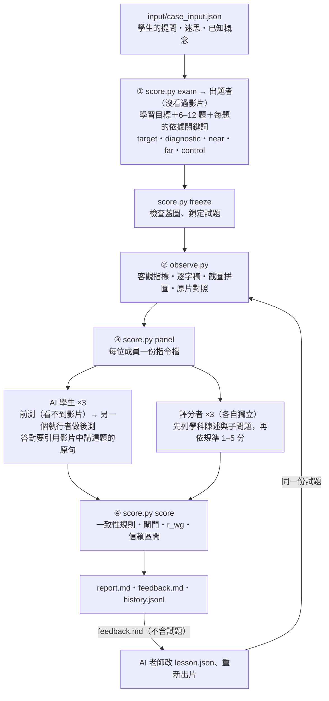

# AskBack AI 學生

給 AskBack 補充教學影片打分數的評量 skill。和 AI 老師（這個 repo 根目錄的 askback-teacher skill）組成迴圈：
老師出片 → 學生評量 → 老師依建議改片 → 再評量。

> 放在 `team/` 底下：這是組內的研究工具，**不是作業的繳交內容**，助教的 agent 不會用到。

## 輸入與輸出

在 AI 老師的同一個工作資料夾（有 `input/` 與 `output/` 的那一層）執行：

| | 檔案 |
|---|---|
| 輸入 | `output/askback.mp4`（或任何 `--video`）、`input/case_input.json`（學生的提問），有的話加上 `input/prefix.mp4`、`input/prefix.vtt` |
| 輸出 | `eval/runs/<run>/report.md`：總分 0–100、95% 信賴區間、四個構念分數、學習成效分、評分者一致性 |
| | `eval/runs/<run>/feedback.md`：給 AI 老師的改片建議（刻意不含試題） |
| | `eval/history.jsonl`：每一版的分數紀錄 |

## 流程



## 分數怎麼來

```
總分 ＝ 0.75 × 規準分 ＋ 0.25 × 學習成效分　（再套用閘門）
```

- **規準分**：照作業評分表的比重。內容正確 35、回應提問與適合程度 30、延續原片教法 20、影音品質 15。每個構念 4–5 題，都有行為定錨的 1–5 分量表，再加上程式量的客觀指標（長度、響度、說話時間比例、字錯率、與原片的語速比）。
- **學習成效分**：AI 學生扮演提問的那位學生，先做前測，再由另一個執行者看影片、做後測。答對但引用不出影片裡講這一題的原句，只給一半分。另有控制題，用來偵測 AI 學生是不是用了自己的知識。前測已經會太多時，這部分的比重會自動降低。
- **和上一版比**：同一題、同一份試題評過的版本，會自動算出差異和差異的 95% 信賴區間。
- **閘門**：沒畫面或沒聲音記 0 分；過半評分者發現內容錯誤，總分上限 60；長度不在 30–90 秒，上限 70；沒有 AI 標示，影音品質上限 40。

設計依據（構念定義、效度論證、信度指標、防止針對考題改片）見 [`instrument/README.md`](instrument/README.md)。

## 實測（2026-10-21，V01 認識昆蟲）

評 10/14 版的 AI 老師影片（75.8 秒），以及把同一支剪掉後半段的對照影片（37.9 秒，蜘蛛的部分沒講）。同一份試題，各 3 位評分者、2 位 AI 學生：

| | 總分（95% CI） | 內容正確 | 回應提問 | 延續原片 | 影音品質 | 學習成效 |
|---|---|---|---|---|---|---|
| 原版 | 81.7（71.7–91.8） | 70.8 | 98.3 | 79.7 | 89.3 | 76.0 |
| 剪半 | 54.7（44.7–64.8） | 61.1 | 35.0 | 76.7 | 83.6 | 39.6 |

- 差異 −27.0（95% CI −35.5～−18.5），工具判定「退步」。掉分集中在「回應提問」與「學習成效」，該掉的掉了；延續原片、影音品質幾乎不變，不該掉的沒掉。
- 三位評分者各自獨立找到同一個真實缺陷：講螞蟻時，「頭、胸、腹」標籤貼在旁邊的甲蟲上，不是螞蟻身上（C1.3 平均 2.0）。
- AI 學生都指出影片沒講「昆蟲有幾隻腳」，學習目標 O2 的達成率因此偏低。迷思欄位明白提到「三對腳」，影片卻沒講，這是影片的真實缺口。
- 開發過程中請了 3 個獨立 agent 審查（心理計量、程式、agent 可用性），依審查結果修正了引文依據的判定、前後測分離、控制題設計、信賴區間與 r*wg 等問題。

## 內容

```
SKILL.md                 agent 讀這份：主持人怎麼跑完一次評量
instrument/README.md     評量設計：構念、效度與信度、進化迴圈、參考文獻
instrument/rubric.json   規準：4 個構念、17 題、1–5 分定錨描述、一致性規則；AI 學生自評 4 題
instrument/scoring.json  權重、客觀指標換算、閘門、信度門檻（調整計分只改這裡）
instrument/test_spec.md  出題規格：學習目標、題目藍圖、題型
prompts/                 出題者、AI 學生（前測／後測）與評分者的指令範本（score.py exam／panel 會填好）
scripts/observe.py       觀察：客觀指標、逐字稿、截圖拼圖、原片對照
scripts/score.py         exam（出題指令）、freeze（鎖定試題）、panel（派工）、score（計分、報告、和上一版比）
scripts/analyze.py       跨影片的信度與效度分析（ICC、α、重測、試題分析、已知組別、效標關聯）
scripts/make_probes.py   做已知較差的對照影片（靜音、剩前半、倍速、句間空白）
scripts/psychometrics.py 統計函式（只用標準函式庫）
fonts/                   Noto Sans TC（拼圖標字用，SIL OFL 1.1）
```

## 安裝

```bash
python3 -m pip install -r requirements.txt
ln -s "$(pwd)" ~/.claude/skills/askback-student     # 在 team/askback-student/ 裡執行；之後在 Claude Code 裡用 /askback-student
```
